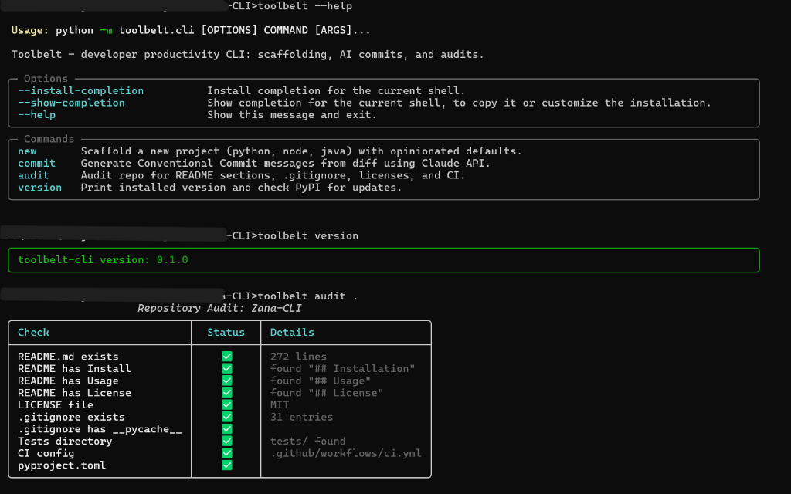

# Toolbelt CLI

<p align="center">
  
</p>

<p align="center">
  <strong>Scaffold projects, draft Conventional Commits, and audit repositories.</strong>
</p>

<p align="center">
  <a href="https://crnjihia.github.io/toolbelt-cli/"></a>
  <a href="https://github.com/crnjihia/toolbelt-cli/actions/workflows/ci.yml"></a>
  <a href="https://pypi.org/project/toolbelt-cli/"></a>
  <a href="https://pypi.org/project/toolbelt-cli/"></a>
  <a href="https://github.com/astral-sh/ruff"></a>
  <a href="https://mypy.readthedocs.io/"></a>
  <a href="https://opensource.org/licenses/MIT"></a>
</p>

---

## Table of Contents
- [Overview](#overview)
- [Installation](#installation)
- [Command Reference](#command-reference)
- [Usage](#usage)
- [Feature Tour & Usage Examples](#feature-tour)
  - [1. Project Scaffolding (`toolbelt new`)](#1-toolbelt-new-type-name)
  - [2. AI-Powered Commits (`toolbelt commit`)](#2-toolbelt-commit)
  - [3. Repository Auditing (`toolbelt audit`)](#3-toolbelt-audit-path)
  - [4. Version Check (`toolbelt version`)](#4-toolbelt-version)
- [Configuration & Environment Variables](#configuration--environment-variables)
- [Architecture & Tech Stack](#architecture--tech-stack)
- [Development & Testing](#development--testing)
- [Deployments](#deployments)
- [Publishing to PyPI](#publishing-to-pypi)
- [Contributing](#contributing)
- [License](#license)

---

## Overview

Toolbelt CLI is a Python 3.11+ command-line utility built with Typer, Rich, and
Jinja2. It provides starter templates for Python, Node.js/TypeScript, and Java,
commit-message drafting from staged Git changes, repository checks, and an
optional PyPI update check.

---

## Installation

### With `pipx` (Recommended)
Isolate CLI tools in their own dedicated virtual environments:
```bash
pipx install toolbelt-cli
```

### With `uv`
Fast single-step tool installation:
```bash
uv tool install toolbelt-cli
```

### With standard `pip`
```bash
pip install toolbelt-cli
```

### Install from source
```bash
git clone https://github.com/crnjihia/toolbelt-cli.git
cd toolbelt-cli
pip install -e ".[dev]"
```

The installation provides both `toolbelt` and `zana` command names.

---

## Command Reference

| Command | Arguments | Flags | Description |
|:---|:---|:---|:---|
| `toolbelt new` | `<type>` `<name>` | `--author`, `--license`, `--ci/--no-ci`, `--docker/--no-docker`, `-y/--yes` | Scaffold an opinionated Python, Node, or Java project. |
| `toolbelt commit` | *(none)* | `--dry-run`, `-t/--type`, `-s/--scope`, `-y/--yes` | Inspect staged diff and generate Conventional Commit message. |
| `toolbelt audit` | `[path=.]` | `--json`, `--fix` | Run 10-point repository audit with Rich table or JSON output. |
| `toolbelt version` | *(none)* | *(none)* | Display installed version and check PyPI for updates. |
| `toolbelt --help` | *(none)* | *(none)* | Show global options and available commands. |

---

## Usage

```bash
toolbelt --help
toolbelt new python my_service
git add src/
toolbelt commit --dry-run
toolbelt audit .
toolbelt version
```

`toolbelt commit` reads staged changes. Use `--dry-run` to preview a message
without creating a commit.

## Feature Tour

### 1. `toolbelt new <type> <name>`
Scaffolds a new project directory. When options are omitted, the command prompts
for author, license, CI, and Docker choices:

```bash
toolbelt new python my_service
```

```text
Author name [Jane Doe]: Jane Doe
License (MIT | Apache-2.0 | none) [MIT]: MIT
Include CI? (y/n) [True]: y
Include Docker? (y/n) [False]: y

┌──────────────────────────── 🎉 Toolbelt Scaffold ────────────────────────────┐
│ ✨ Project successfully scaffolded!                                         │
│                                                                             │
│ Next steps:                                                                 │
│ cd my_service && make install && make test                                  │
└─────────────────────────────────────────────────────────────────────────────┘
```

#### Supported Stacks & Project Layouts

- **Python (`toolbelt new python <name>`)**:
  - `src/<name>/__init__.py`, `main.py`
  - `tests/test_main.py`
  - `pyproject.toml` (configured with Ruff, MyPy, and Pytest)
  - `.pre-commit-config.yaml`
  - `Makefile` (`install`, `test`, `lint`, `format`, `clean`)
  - `README.md`, `.gitignore`, and optionally `LICENSE`
  - `.github/workflows/ci.yml` when CI is enabled
  - `Dockerfile` when Docker is enabled

- **Node.js / TypeScript (`toolbelt new node <name>`)**:
  - `package.json` (TypeScript, ESLint, Prettier, and Vitest dependencies/scripts)
  - `tsconfig.json`
  - `src/index.ts`, `src/index.test.ts`
  - `.eslintrc.json`, `.prettierrc`
  - `README.md`, `.gitignore`, and optionally `LICENSE`

- **Java (`toolbelt new java <name>`)**:
  - `pom.xml` (Maven, JUnit 5 Jupiter, compiler plugins)
  - `src/main/java/com/<name>/App.java`
  - `src/test/java/com/<name>/AppTest.java`
  - `README.md`, `.gitignore`, and optionally `LICENSE`

`--yes` accepts defaults: the configured Git author (or `Developer`), MIT license,
CI enabled, and Docker disabled. CI and Docker templates are currently available
for Python projects.

---

### 2. `toolbelt commit`
Reads your staged git diff (`git diff --staged`) and drafts a Conventional Commit message:

```bash
git add src/
toolbelt commit
```

```text
┌────────────────────────── Proposed Commit Message ──────────────────────────┐
│ feat(auth): add bearer token validator and refresh middleware              │
└─────────────────────────────────────────────────────────────────────────────┘
Apply commit? [y/n/edit] (y): y
✅ Commit created successfully!
```

- **Claude integration**: Set `ANTHROPIC_API_KEY` to draft a message with the Anthropic API (`claude-sonnet-4`). The staged diff is sent to Anthropic when this is enabled.
- **Local fallback**: Without an API key, a heuristic uses the diff to draft a message without making a network call.
- **Dry-run Mode**: Preview generated messages without applying commits using `toolbelt commit --dry-run`.
- **Confirmation**: Review, edit, or reject the proposed message before committing. `--yes` skips confirmation.

Use `--type` and `--scope` to provide parts of the commit header:

```bash
toolbelt commit --type feat --scope cli
```

---

### 3. `toolbelt audit [path]`
Performs a structured quality check on any repository:

```bash
toolbelt audit .
```

- **Auto-Fix (`--fix`)**: Prompts to create a missing `.gitignore` and/or MIT or Apache-2.0 `LICENSE`. It does not repair other failed checks.
- **JSON Mode (`--json`)**: Outputs machine-readable JSON for integration into reporting tools or CI/CD pipelines.
- **Exit status**: Returns `0` when all checks pass and `1` when one or more checks fail.

---

### 4. `toolbelt version`
Displays installed package version and checks whether updates are available on PyPI:

```bash
toolbelt version
```

---

## Configuration & Environment Variables

The optional `ANTHROPIC_API_KEY` environment variable is used by `toolbelt commit`.
The CLI does not load `.env` files; set the variable in your shell before running
the command.

PowerShell:

```powershell
$env:ANTHROPIC_API_KEY = "your-api-key"
toolbelt commit
```

macOS/Linux:

```bash
export ANTHROPIC_API_KEY="your-api-key"
toolbelt commit
```

Without this variable, commit-message generation uses the local fallback.

---

## Architecture & Tech Stack

```text
toolbelt-cli/
├── src/toolbelt/
│   ├── cli.py             # Typer application definition and routing
│   ├── commands/          # Subcommand handlers (new, commit, audit, version)
│   ├── services/          # Scaffolder, LLM Commit Generator, and Auditor
│   ├── templates/         # Jinja2 project templates (python, node, java)
│   └── utils/             # Git interface, Rich console helpers
├── tests/                 # Full offline pytest test suite with CliRunner
└── .github/workflows/     # CI matrix & PyPI Trusted Publishing release
```

- **CLI Framework**: [Typer](https://typer.tiangolo.com/)
- **Terminal UI**: [Rich](https://rich.readthedocs.io/)
- **Templating**: [Jinja2](https://jinja.palletsprojects.com/)
- **HTTP Client**: [HTTPX](https://www.python-httpx.org/)
- **LLM Integration**: [Anthropic Python SDK](https://github.com/anthropics/anthropic-sdk-python)
- **Quality**: [Ruff](https://astral.sh/ruff) & [MyPy](https://mypy.readthedocs.io/)
- **Testing**: [Pytest](https://docs.pytest.org/) & `CliRunner`

---

## Development & Testing

Run the automated test suite locally:

```bash
# Run unit and integration tests (100% offline)
pytest -v

# Check linting and style
ruff check .
ruff format --check .

# Run static type analysis
mypy src
```

---

## Deployments

GitHub Actions manages CI, the documentation site, and PyPI releases:

- **CI** ([`.github/workflows/ci.yml`](.github/workflows/ci.yml)) runs on pushes and pull requests targeting `main`. It tests Python 3.11 and 3.12 with Ruff, MyPy, and Pytest.
- **Documentation** ([`.github/workflows/pages.yml`](.github/workflows/pages.yml)) deploys the static `docs/` site to GitHub Pages when documentation or its workflow changes on `main`; it can also be started manually. In repository settings, Pages must use **GitHub Actions** as its deployment source.
- **Release** ([`.github/workflows/release.yml`](.github/workflows/release.yml)) runs for tags matching `v*`. It builds and checks a wheel and source archive, publishes them to PyPI using Trusted Publishing (OIDC), and attaches both files to the matching GitHub Release.

### Configure PyPI Trusted Publishing

Before the first release, register a publisher on PyPI for the **`toolbelt-cli`**
project with these exact values:

| PyPI setting | Value |
|---|---|
| Owner | `crnjihia` |
| Repository | `toolbelt-cli` |
| Workflow filename | `release.yml` |
| Environment name | `pypi` |

The GitHub repository must also have a `pypi` environment. The build and
distribution checks can pass even when publishing is not configured; in that case,
the publish step fails with an `invalid-publisher` error. Configure the publisher
in the PyPI project settings. Do not add a PyPI API token to the workflow for this
OIDC setup.

For a release, update the version in `pyproject.toml` and `src/toolbelt/__init__.py`,
update `CHANGELOG.md`, then push a version tag:

```bash
git tag v0.3.0
git push origin v0.3.0
```

---

## Contributing

Contributions are welcome! Please follow these steps:

1. Fork the repository on GitHub.
2. Create a feature branch: `git checkout -b feat/my-new-feature`
3. Ensure tests, lint, formatting, and type checks pass: `pytest -v`, `ruff check .`, `ruff format --check .`, and `mypy src`.
4. Commit your changes using conventional commits: `git commit -m "feat(scope): describe change"`
5. Open a Pull Request.

---

## License

Distributed under the [MIT License](LICENSE).
